# LeadVault AI: Enterprise Agentic AI Engineering Programme (V1 to V11)

**Document ID:** `LV-DOC-PROG-008`  
**Date:** 2026-11-01  
**Project:** LeadVault AI (Autonomous B2B Buyer-Intent & Lead-Mining Intelligence)  
**Author:** LeadVault Principal Architect & Engineering Lead  
**Methodology Standard:** Inherited from the SEORocket V1–V11 Engineering Control Framework  

---

## 1. Programme Vision & Evolutionary Model

The LeadVault AI enterprise programme transitions the application from a deterministic, single-machine buyer-intent filter into an autonomous, distributed, self-improving revenue intelligence operating system.

Every specialist domain advances through the **11-Stage Agentic Maturity Ladder**:

```mermaid
flowchart LR
    V1["V1: MVP / Deterministic"] --> V2["V2: Naive RAG & ICP"]
    V2 --> V3["V3: Tool Gateway & Sandbox"]
    V3 --> V4["V4: Stateful Workflows"]
    V4 --> V5["V5: Multi-Agent Mesh"]
    V5 --> V6["V6: Episodic Learning"]
    V6 --> V7["V7: Deep Research"]
    V7 --> V8["V8: Scale & Queuing"]
    V8 --> V9["V9: Predictive Scoring"]
    V9 --> V10["V10: Enterprise Governance"]
    V10 --> V11["V11: Closed-Loop OS"]
```

---

## 2. Version-by-Version Architectural Roadmap

### Version 1.0 — MVP & Deterministic Foundation
- **Maturity Milestone:** Core Application & Baseline Rules
- **Capabilities Delivered:**
  - FastAPI async backend serving core lead-mining endpoints.
  - Next.js 14 App Router UI providing dashboard shell, file dropzone, and run history.
  - Deterministic regex pattern matching over 150+ procurement phrases.
  - Basic JSON persistence for specs (`leadvault_specs.json`), accepted leads (`accepted_exports.json`), and rejected audits (`rejected_audits.json`).
  - Zero unsolicited bulk sending policy enforced.
- **Verification Gate:** 22 baseline unit tests passing.

---

### Version 2.0 — Contextual Retrieval & ICP Tuning
- **Maturity Milestone:** Mining Brain & Parameter Generation
- **Capabilities Delivered:**
  - Automated translation of client ICP spreadsheets (CSV/XLSX) into structured **Mining Brains**.
  - Synthesis of targeted LinkedIn parameter filters and Google Boolean query strings.
  - Multi-tenant client workspace discovery (`GET /api/leadvault/tenants`).
  - Baseline gold corpus evaluation dataset established (`gold_corpus.jsonl`).
- **Verification Gate:** Spec serialization roundtrip verified; gold corpus baseline scored.

---

### Version 3.0 — Structured RAG & Tool Sandbox
- **Maturity Milestone:** Governed Network Gateway & Tool Execution
- **Capabilities Delivered:**
  - Out-of-band `ToolGateway` in `backend/harness/tools.py`.
  - Comprehensive Server-Side Request Forgery (SSRF) protection blocking private IP subnets (`127.0.0.1`, `10.0.0.0/8`, `192.168.0.0/16`, `169.254.169.254`, loopbacks, and non-HTTP schemes).
  - External scraping bridge connecting to Apify actors with token-bucket budget limits.
  - Whitelisted tool execution logging every call to an append-only audit trail.
- **Verification Gate:** 100% pass on SSRF injection tests (`TestToolGateway`).

---

### Version 4.0 — Stateful Agentic Workflows & Control Harness
- **Maturity Milestone:** Agentic State Machine & Human-in-the-Loop Governance
- **Capabilities Delivered:**
  - Mining execution state machine (`backend/harness/workflow.py`) with transition auditing.
  - Triad policy engine (`policy.py`) strictly enforcing `ALLOW`, `REQUIRE_APPROVAL`, and `DENY`.
  - Human-in-the-loop pending approval queue (`approvals.py`) holding borderline leads (confidence 0.50–0.69) until explicit operator sign-off.
  - Advisory LLM arbitration bridge (`llm.py`) supporting Ollama, Anthropic, and OpenAI, wrapped in prompt-injection containment tags.
  - `FinalVerifier` anti-hallucination engine enforcing dual-proof need and vetoing fooled models.
- **Verification Gate:** **115/115 Unit, Adversarial, and Harness Tests Passing.**

---

### Version 5.0 — Multi-Agent Collaboration Mesh
- **Maturity Milestone:** Specialized Agent Handoffs & Coordinator Topology
- **Capabilities in Development:**
  - Formal Agent Registry (`backend/harness/registry.py`) establishing declared autonomy levels and contracts.
  - Agent delegation topology:
    - `OrchestratorAgent`: Decomposes mining runs across target channels.
    - `CrawlerAgent`: Mines live public signals via governed tool gateways.
    - `IntentAgent`: Executes two-tier classification and scoring.
    - `EnrichmentAgent`: Cross-references company databases for revenue/contact data.
  - HMAC-signed inter-agent messaging bus preventing impersonation.
- **Verification Gate:** Multi-agent trace logs demonstrate clean handoffs with zero unhandled exceptions.

---

### Version 6.0 — Episodic Memory & Continuous Learning
- **Maturity Milestone:** Hermes Autonomous Learning Loop
- **Capabilities Planned:**
  - Integration of three memory tiers:
    1. *Working Memory:* In-flight lead candidate state.
    2. *Episodic Memory:* Historical mining runs, operator approval/rejection reasons, and sales outcome feedback.
    3. *Semantic Memory:* Client ICP profiles, industry taxonomy, and buying signal embeddings.
  - Automated reflection loops: Adjusts regex confidence weights based on sales conversion feedback (closed-won vs. closed-lost leads).
- **Verification Gate:** Lead precision improves from 85% to >88% on real-world sales validation data.

---

### Version 7.0 — Deep Research & Expansion Signal Intelligence
- **Maturity Milestone:** Dark Intent & Multi-Source Cross-Verification
- **Capabilities Planned:**
  - Autonomous crawling of 3,000+ public sources (Google RFPs, Upwork, Fiverr, Reddit, GitHub issues).
  - Executive leadership change tracking (monitors new CMO/VP hires within their first 90 days).
  - Corporate expansion signals (geographic branch openings, tech stack migrations, funding announcements).
  - Signal recency enforcement: Automatic prioritization for signals <48 hours old.
- **Verification Gate:** Signal freshness P90 < 24 hours; zero outdated (>30 day) opportunities delivered.

---

### Version 8.0 — Distributed Queuing & Database Sharding
- **Maturity Milestone:** Enterprise Scale & High-Throughput Processing
- **Capabilities Planned:**
  - Database sharding: Partition 1M+ company database across 10 PostgreSQL shards keyed by `company_id`.
  - Kafka / Celery distributed message broker buffering 10,000+ lead intake bursts.
  - Parallel worker pool sustaining 1,000 leads/minute qualification throughput.
  - P95 query response time under 100ms per lead.
- **Verification Gate:** Load testing verifies 10,000 leads processed in <15 minutes with zero message drops.

---

### Version 9.0 — Predictive Optimization & Revenue Valuation
- **Maturity Milestone:** Machine Learning Deal Size & Conversion Scoring
- **Capabilities Planned:**
  - Predictive deal valuation algorithm estimating project budgets ($15K tactical to $250K strategic).
  - Machine learning reranker prioritizing accounts with the highest conversion probability.
  - Dynamic outreach copy personalization generating prospect-specific email hooks derived directly from extracted pain points.
- **Verification Gate:** Deal valuation correlates with actual customer contract values (>0.75 Pearson correlation).

---

### Version 10.0 — Production Governance & Enterprise Compliance
- **Maturity Milestone:** SOC2, GDPR, CCPA, and Regulatory Hardening
- **Capabilities Planned:**
  - Cryptographic tamper-evident audit log signing with daily hash chaining.
  - Automated PII scrubbing and data retention pruning (90-day rolling expiration).
  - Role-Based Access Control (RBAC) with granular tenant operator permissions (Admin, Reviewer, Read-Only).
  - Formal GDPR Article 6(1)(f) legitimate interest documentation hub.
- **Verification Gate:** External penetration test and automated SOC2 compliance checklist pass.

---

### Version 11.0 — Autonomous Closed-Loop Operating System
- **Maturity Milestone:** Self-Healing & Self-Tuning Agentic Platform
- **Capabilities Planned:**
  - Continuous background evaluation running hourly golden corpus sanity checks.
  - Automated model failover (switches between Claude 3.5 Sonnet, GPT-4o, and local Ollama if an API degrades).
  - Bi-directional CRM closed-loop feedback: Automatically ingests deal stage movements to refine query parameters.
  - Self-healing crawler circuit breakers isolating failing proxy networks.
- **Verification Gate:** 99.9% uptime SLA; fully autonomous operation with human touch required only for high-value deal approvals.
