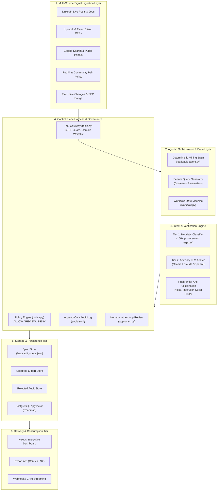

# LeadVault AI: Comprehensive Enterprise Product Blueprint

**Document ID:** `LV-DOC-BLUEPRINT-006`  
**Date:** 2026-11-01  
**Project:** LeadVault AI  
**Author:** LeadVault Principal Systems Architect  

---

## 1. System Vision & Architecture Topology

LeadVault AI is an enterprise-grade, agentic autonomous system engineered to discover, verify, score, and deliver active B2B purchasing demand. The platform bridges the gap between raw, unstructured internet communication and structured, actionable sales intelligence.

---

## 2. Core Functional Modules & Domain Breakdown

### Module 1: ICP Synthesis & Mining Brain Engine
- **Component:** `backend/services/leadvault_agent.py`
- **Purpose:** Ingests raw client ICP inputs (company services, target industries, geography, deal size, negative targeting rules) and synthesizes a deterministic **Mining Brain**.
- **Outputs:**
  - Standardized Buying Intent Clusters (e.g., "Agency Search", "Vendor Replacement", "Technical Rebuild").
  - Parametric LinkedIn search terms (title filters, industry codes).
  - Boolean Google/Serp query matrix (`site:linkedin.com/posts "looking for an agency" OR "recommend a consultant"`).
  - Anti-patterns to immediately discard (e.g., `"we are hiring"`, `"internship"`, `"I offer services"`).

---

### Module 2: Multi-Source Signal Ingestion Gateway
- **Component:** `backend/services/leadvault_mining_runner.py` & `backend/harness/tools.py`
- **Purpose:** Executes safe, governed web crawling across public portals without violating terms of service or exposing internal network resources.
- **Security Invariants:**
  - Network Gateway enforces strict SSRF filtering (blocks private IPs, `127.0.0.1`, `169.254.169.254`, `10.0.0.0/8`, metadata endpoints).
  - Token-bucket rate limiting prevents API quota exhaustion on Apify and external providers.
  - Public signals only: 100% compliant with GDPR/CCPA regulations.

---

### Module 3: Two-Tier Buying Intent Classifier
- **Component:** `backend/services/buying_intent_agent.py`
- **Architecture:**
  - **Tier 1 (Deterministic Fast Path):** Evaluates candidate text against 150+ high-precision procurement regexes. Generates a base intent score (0.00 – 1.00). If score is unequivocally high (≥0.85) or unequivocally noise (<0.50), classification resolves in <2ms without LLM cost.
  - **Tier 2 (Advisory LLM Arbitration):** For borderline signals (0.50 – 0.69), routes untrusted signal snippets wrapped in protective isolation tags to an advisory model (Ollama local, Anthropic Claude, or OpenAI). Model verdict is strictly advisory: a fooled model cannot promote a seller pitch into an accepted export.

---

### Module 4: Anti-Hallucination & Final Verification Pipeline
- **Component:** `backend/services/final_verifier.py`
- **Responsibilities:**
  - Enforces mandatory dual-condition proof: (1) Active business problem/need, AND (2) Explicit intent to hire external help.
  - Eliminates recruitment noise (e.g., `"We're hiring a full-time Senior React Dev"`).
  - Eliminates vendor pitches (e.g., `"Need help with SEO? DM us for our agency packages"`).
  - Verifies contact ground truth: Never synthesizes or hallucinates emails or phone numbers. If contact data is not present in the public signal, the lead is preserved with empty contact fields rather than fabricated entries.

---

### Module 5: Lead Enrichment & Dossier Synthesis
- **Target Schema:** Standardized 15 Contact Fields, 24 Sales Fields, and 29 Revenue Intelligence Fields.
- **Enrichment Attributes:**
  - **Company Intelligence:** Revenue tier ($5–50M, $50–250M, $250M+), headcount, primary tech stack.
  - **Decision-Maker Mapping:** Identification of Budget Holder, Influencer, or Technical User.
  - **Deal Quantification:** Deal size estimation ($15K tactical to $250K strategic) and urgency scoring.
  - **Outreach Prescription:** Recommended next best action, tailored value proposition angle, and copy hook based directly on the prospect's extracted pain point.

---

### Module 6: Control Plane Harness & Governance Engine
- **Components:** `backend/harness/policy.py`, `audit.py`, `approvals.py`, `workflow.py`
- **Capabilities:**
  - **Policy Enforcement:** Strict triad of `ALLOW`, `REQUIRE_APPROVAL`, and `DENY`. Outbound automated emails and direct CRM mutations without review are hard-denied.
  - **Immutable Audit Trail:** All tool invocations, user decisions, model inferences, and policy checks are serialized to an append-only JSONL log with tamper-evident record identifiers.
  - **Human-in-the-Loop Review Queue:** Hot leads or model-promoted borderline leads are held in a pending approval state until an authorized human operator confirms or rejects the record.

---

### Module 7: Multi-Tenant Workspace & Client Isolation
- **Component:** `backend/runtime/` & `backend/api/routes/`
- **Capabilities:**
  - Strict tenant boundary isolation: Leads, mining runs, approval queues, and saved specs cannot leak between client workspaces.
  - Cross-tenant approval rejection: API returns HTTP 409 Conflict if an operator attempts to decide an approval belonging to another client tenant.

---

### Module 8: Golden Benchmark Evaluation Suite
- **Component:** `backend/evaluation/harness.py` & `gold_corpus.jsonl`
- **Capabilities:**
  - Automated CI/CD regression testing across real-world signal samples.
  - Tracks Precision, Recall, F1 Score, and False Positive Rate across model iterations and regex expansions.
  - Prevents prompt regression and accuracy degradation before production deployment.
