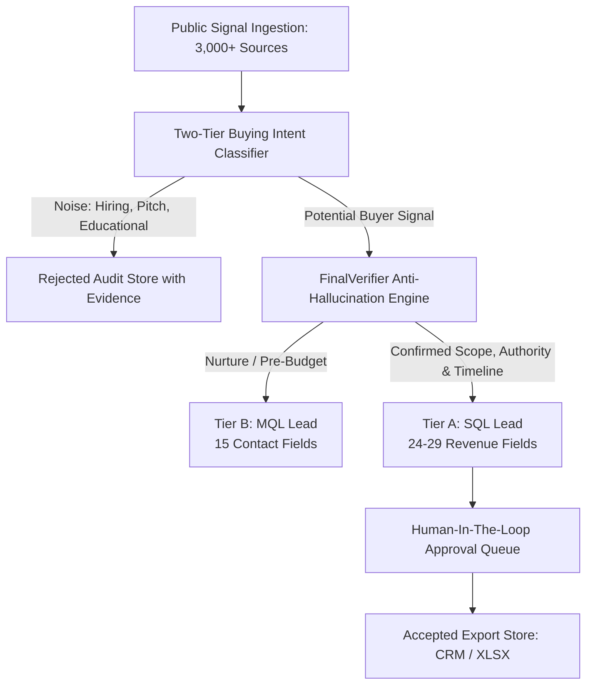

# LeadVault AI: Comprehensive Product Discovery & Market Intelligence Report

**Document ID:** `LV-DOC-PROD-001`  
**Date:** 2026-11-01  
**Project:** LeadVault AI (Autonomous B2B Buyer-Intent & Lead-Mining Intelligence)  
**Parent Entity:** GetHired Digital  
**Live Public Endpoint:** [https://leadvaultai.com/](https://leadvaultai.com/) (canonical mirror: `https://leadvault.gethireddigital.com/`)  
**Primary Test Target:** `https://github.com/saileshpattnaik357/LEADVAULT_AGENT_TEST_REPO`  
**Active Production Mirror:** `https://github.com/LeadVaultAI/LEADVAULTAI_TEST_PROJECT.git`

---

## 1. Executive Summary & Brand Identity

**LeadVault AI** is an autonomous, agentic AI-powered B2B lead generation, buyer-intent discovery, and procurement intelligence system developed by **GetHired Digital**. 

Unlike conventional static contact scrapers (e.g., Apollo, ZoomInfo) that sell commoditized, cold contact lists or generic email blasts that result in spam fatigue, LeadVault operates on a fundamental thesis:

> **"The difference is intent. Zero cold leads. We do not manufacture leads to fill a quota. We find prospects who have already raised their hand and announced an active need, budget, or RFP."**

The platform deploys 24/7 autonomous agentic workers across **3,000+ public portals, freelance platforms, and professional networks** to detect, verify, qualify, and deliver high-intent B2B buying signals with **94%+ accuracy**.

---

## 2. Market Problem & Strategic Value Proposition

### 2.1 The Crisis in B2B Lead Generation
1. **Cold Email Collapse:** Deliverability updates (Google/Yahoo DMARC enforcements) and widespread recipient burnout have driven traditional cold email response rates below 1%.
2. **Static Database Decay:** 30%+ of static B2B database contacts decay annually due to job changes, layoffs, and re-organizations.
3. **Wasted SDR Bandwidth:** Sales Development Representatives (SDRs) spend 65%+ of their working hours manually scouring job boards, LinkedIn posts, and RFP boards, or qualifying unresponsive leads.
4. **False Intent Signals:** Content syndication downloads and whitepaper views are routinely mistaken for purchasing intent, wasting senior executive selling time.

### 2.2 LeadVault's High-Intent Solution
| Traditional Prospecting | LeadVault AI Agentic Intelligence |
|---|---|
| Mass cold email to static lists | Real-time discovery of live buying triggers |
| 5 manual sites checked intermittently | 3,000+ public sources crawled continuously |
| 40 hours of manual SDR research per batch | Automated synthesis in under 5 minutes |
| Raw screenshots, unstructured notes | Standardized 24–29 field structured intelligence |
| High spam complaint rate | GDPR/CCPA compliant; 100% public signal sourcing |
| Guesswork on timing and budget | Verified budget holder, timeline, and scope criteria |

---

## 3. Lead Qualification Hierarchy & Tiers

LeadVault structures prospective buyers into rigorous operational tiers:

### 3.1 Lead Tiers
1. **SQL (Sales Qualified Lead — Tier A):**
   - **Definition:** A prospect with confirmed budget, defined project scope, clear timeline (`immediate` or `1–3 months`), and verified decision-making authority (Budget Holder, C-Suite, VP).
   - **Delivery:** Immediate push to CRM webhook, instant Slack alert, full 29-field dossier.
   - **Commercial Value:** High-ticket tactical and strategic projects ($15K–$250K deal size).
2. **MQL (Marketing Qualified Lead — Tier B):**
   - **Definition:** A prospect that has expressed pain points or verified interest in an external solution but lacks an explicit budget declaration or immediate procurement timeline.
   - **Delivery:** Nurture sequences, retargeting inputs, mid-tier export.
3. **Disqualified Noise (Tier C / Rejected):**
   - **Categories:** Direct job recruitment (hiring internal staff), vendor self-promotion ("We help companies..."), generic educational/thought leadership, spam, student requests.
   - **Governance:** Logged to append-only `rejected_audits.json` with exact extraction rationale for transparent auditing.

---

## 4. Signal Sourcing & Intelligence Matrix

LeadVault AI monitors five primary signal archetypes across 3,000+ sources:

1. **Explicit Vendor Requests:**
   - *"Looking for an agency to rebuild our Shopify Plus store"*
   - *"Can anyone recommend a vetted B2B SEO consultant?"*
   - *"RFP issued for healthcare compliance auditing partner"*
2. **Expansion & Hiring Saturation Signals:**
   - Rapid expansion into new territories without local domain staff.
   - Repeated failed job postings for niche technical roles (triggers vendor outsourcing).
3. **Executive & Leadership Transitions:**
   - New CMO, VP Growth, or CTO appointments (typically re-evaluate tech stacks and agency rosters within the first 90 days).
4. **Funding & Capital Allocation Triggers:**
   - Seed, Series A/B announcements paired with stated scaling milestones.
5. **Technology Stack Migration & Replacement:**
   - Public queries seeking migration off legacy platforms (e.g., Magento to Shopify, Salesforce to HubSpot).

---

## 5. Structured Data Schema & Fields

Every delivered lead is enriched with multi-dimensional intelligence:

| Category | Field Count | Core Fields |
|---|---|---|
| **Contact Intelligence** | 15 Fields | Full Name, Verified Business Email, Direct LinkedIn Profile, Clean Title, Seniority Level, Phone (where public), Location/Timezone, Company Domain. |
| **Sales Intelligence** | 24 Fields | Company Name, Industry Sub-Vertical, Headcount Band, Revenue Band ($5–50M, $50–250M, $250M+), Buying Intent Trigger, Extracted Need Summary, Urgency Rating, Recommended Outreach Angle, Next Best Action. |
| **Revenue Intelligence** | 29 Fields | Estimated Deal Value ($15K tactical to $250K strategic), Technology Stack Footprint, Competitor Overlap, RFP Submission Deadline, Procurement Authority Type (Budget Holder, Influencer, End-User), Compliance Verification Tag. |

---

## 6. Commercial Model & Packaging

As verified from the live platform (`leadvaultai.com`):

1. **Pay Per Run (On-Demand):**
   - Target: Founders, boutique consultancies, and pilot pipeline validation.
   - Mechanics: Upload client ICP, execute targeted run, pay per batch of verified MQLs/SQLs.
   - Guarantee: 100% free replacement on bounced emails, inactive profiles, or out-of-ICP deliveries.
2. **Pipeline Pro (Growth Retainer):**
   - Target: Scaling B2B agencies and enterprise sales teams.
   - Features: Monthly allocation of high-intent SQLs + MQLs, continuous AI ICP tuning, automated CRM sync, negative targeting exclusion filters.
3. **Vault Elite (Enterprise Custom):**
   - Target: Multi-division corporations and lead generation agencies reselling intelligence.
   - Features: Dedicated autonomous crawling workers, private proxy clusters, custom LLM fine-tuning on proprietary sales outcome data, SLA guarantees.

---

## 7. Comparative Delta: Public Face vs. Internal Implementation

| Capability Domain | Public Site (`leadvaultai.com`) | Current Local Implementation (`D:\ANTIGRAVITY\LEADVAULT`) | Target Enterprise Programme (V1–V11) |
|---|---|---|---|
| **Interface** | Lovable / Vite static marketing SPA | Next.js 14 App Router + Tailwind interactive control plane | Unified enterprise dashboard with multi-tenant workspace switcher |
| **Signal Engine** | Advertised 3,000+ autonomous web crawlers | Apify crawler bridge + Boolean Google/LinkedIn generator | Distributed Celery/Redis queue workers + WebMCP connector mesh |
| **AI Processing** | "Autonomous AI Agents" | Two-tier heuristic + Ollama/OpenAI advisory verification | LangGraph multi-agent DAG + RAG over Crunchbase/SEC/RFP data |
| **Governance** | GDPR/CCPA compliance promise | Out-of-band Policy Engine (`policy.py`), Audit Log (`audit.py`), Human Approvals | Cryptographic tamper-evident audit logs, SOC2/HIPAA compliance gates |
| **CRM Integration** | Advertised Webhook / CSV | Local XLSX/CSV exporter (`accepted_exports.json`) | Bi-directional HubSpot, Salesforce, Close, and webhook streaming |

---

## 8. Strategic Product Roadmap Directives

1. **Preserve Determinism:** Never let generative LLMs invent contact emails, company revenues, or phantom buying signals. The deterministic heuristic engine must remain the ultimate gatekeeper.
2. **Speed to Action:** Lead value degrades exponentially with age. Fresh signals (<48 hours) convert at 35%+; signals >14 days convert at <5%. Priority routing for immediate notifications is essential.
3. **Evidence First:** Every lead must carry its exact raw signal excerpt, source URL, and timestamp so the sales rep has immediate context before initiating outreach.
