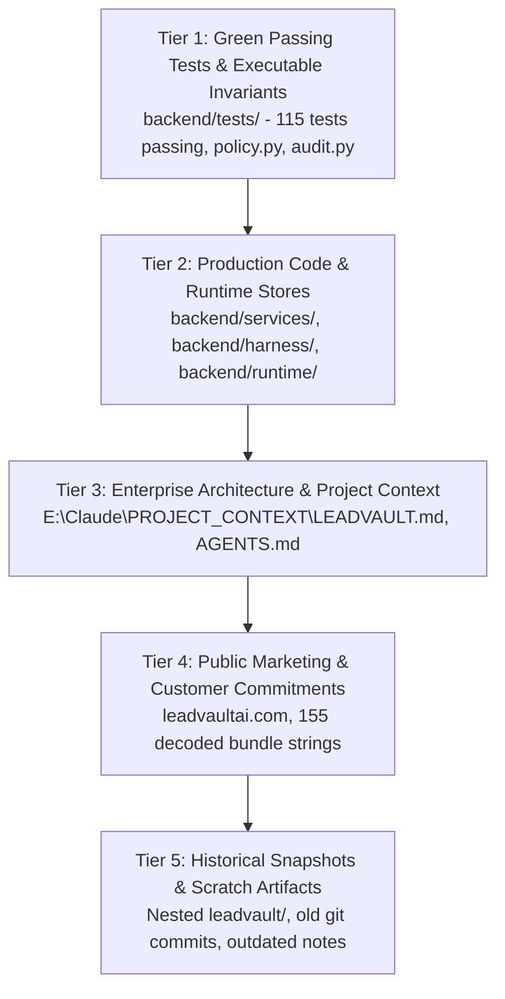

# LeadVault AI: Authoritative Source of Truth Hierarchy & Architectural Standards

**Document ID:** `LV-DOC-ARCH-004`  
**Date:** 2026-11-01  
**Project:** LeadVault AI  
**Author:** LeadVault Principal Recovery Engineer & Chief Architect  

---

## 1. Principles of Reconciliation & Precedence

When multiple development versions, specifications, and external web materials exist, architectural drift and hallucinated features easily occur if strict precedence is not enforced. 

LeadVault AI adheres to the following **Five-Tier Hierarchy of Truth**:

---

## 2. Definitive Hierarchy of Sources

### Level 1: Executable Policy, Security & Test Invariants (Supreme Truth)
- **Primary Files:**
  - `backend/tests/test_adversarial.py`
  - `backend/tests/test_harness.py`
  - `backend/tests/test_buying_intent_classifier.py`
  - `backend/harness/policy.py`
- **Rule:** If any architectural document or marketing claim violates a passing test or security policy (e.g., claiming automated unsolicited bulk email sending, which is strictly denied in `policy.py`), the test/policy invariant overrides all other claims.
- **Enforced Invariants:**
  1. *Anti-Spam / Anti-Unsolicited Outreach:* Automated unapproved external writes are hard-blocked (`ALLOW`, `REQUIRE_APPROVAL`, `DENY` policy matrix).
  2. *Anti-Hallucination:* Generative models can advise on borderline classifications, but CANNOT fabricate contact emails, revenue bands, or create ungrounded leads.
  3. *Tenant Isolation:* Leads, runs, and specs cannot be accessed, approved, or exported across client tenant boundaries.

---

### Level 2: Production Service Implementation & Runtime Stores
- **Primary Files:**
  - `backend/services/buying_intent_agent.py` (Confidence scoring, heuristic triggers)
  - `backend/services/final_verifier.py` (Multi-stage rejection pipeline)
  - `backend/services/leadvault_mining_runner.py` (Mining orchestrator)
  - `backend/harness/` (Control plane, tool gateway, audit logger, workflow state machine)
  - `backend/runtime/` (`leadvault_specs.json`, `accepted_exports.json`, `rejected_audits.json`, `audit.jsonl`)
- **Rule:** The verified runtime codebase represents what the system actually does in production today. New capabilities build upon these interfaces without breaking backwards compatibility.

---

### Level 3: Enterprise Architecture & Methodology Standards
- **Primary Files:**
  - `E:\Claude\PROJECT_CONTEXT\LEADVAULT.md` (14 enterprise scaling skills, 3-agent domain topology, sharding and Kafka specs)
  - `D:\ANTIGRAVITY\LEADVAULT\AGENTS.md` (Procurement Intelligence Standard)
  - `E:\Sailesh\Gethired Global\DIGIX\Tech\SEO_ROCKET` (SEORocket V1–V11 Master Methodology)
- **Rule:** Governs how the product scales from its current V1/V2 state into an enterprise autonomous agentic platform across V3 through V11.

---

### Level 4: Public Customer Experience & Product Packaging
- **Primary Files:**
  - Public endpoint `https://leadvaultai.com/`
  - Extracted bundle copy (`C:\Users\sailesh\.gemini\antigravity\brain\...\scratch\bundle_strings.txt`)
  - GTM documentation (`E:\Sailesh\Gethired Global\Leadvault\All website files\`)
- **Rule:** Defines customer-facing terminology, pricing plans (Pay Per Run, Pipeline Pro, Vault Elite), data schemas (15 contact fields, 24 sales fields, 29 revenue fields), and warranty criteria (free replacements on bounce/inaccuracy).

---

### Level 5: Historical & Deprecated Snapshots (Archival Only)
- **Primary Files:**
  - Nested directory `D:\ANTIGRAVITY\LEADVAULT\leadvault\`
  - Deprecated GitHub remote `https://github.com/rxgptgethiredglobal/leadvault.git`
  - Older backup zips (`leadvault-by-gethired-digital-3.zip`)
- **Rule:** Preserved for provenance and recovery tracing, but NEVER imported or allowed to overwrite active root implementations.

---

## 3. Policy on Conflict Resolution

When a conflict is detected between sources:
1. **Never Silently Merge:** Identify and document the discrepancy in the Git reconciliation ledger.
2. **Security & Accuracy Win:** If a feature proposal reduces classification accuracy below 85% or introduces SSRF/injection risks, it is blocked.
3. **Traceability:** Every accepted lead record must maintain an unbroken link to its raw source evidence and audit log entry.
